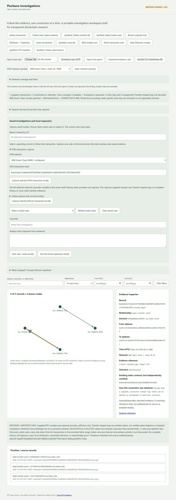

# Positano Investigations

An open-source starting point for portable blockchain investigations: inspect a graph, follow its source transactions, and export evidence for other tools.

**v0.9 prototype: 11 EVM mainnets plus bounded Bitcoin/Solana investigations, saved cases, and shareable cards.** Preserve evidence, keep analyst notes separate, reopen investigations after restart, and collect a bounded next hop from the interface. Existing receipt, asset, bridge, and launch-observation decoders remain available. This is a bounded investigation workspace, not a full blockchain indexer or a production forensic platform.



## Run locally

Python 3.11+; no pip installs or wallet connection. Offline examples and Bitcoin/Solana public defaults need no API key; EVM capture requires a configured HTTPS provider.
The local service and cross-network builder/capture require Node 22+. Keccak uses pinned, attributed Noble modules already vendored in the repository; no npm install is needed.

```sh
python serve.py
# Open http://127.0.0.1:8080
python kit.py eth examples/eth-snapshot.synthetic.json case.json
python kit.py eth examples/eth-snapshot.synthetic.json case.gs --gs
python kit.py sol examples/launch-map.synthetic.json solana-case.json
python kit.py rpc examples/eth-receipt.mainnet.json receipt-case.json
python assemble.py combined-case.json examples/eth-receipt.mainnet.json examples/eth-receipt-second.mainnet.json
node bridge.mjs build examples/op-deposit.mainnet.json cross-network-case.json
python -m unittest discover -s tests -v
# Optional developer check, using Node 22+ (no npm install):
node --test tests/*.test.mjs
```

Output paths must be new. Keep private investigations in an untracked `private-cases/` folder. Use **Open local case** to inspect a CLI-produced case JSON. In static/offline mode, files are validated and opened in browser memory; they are not uploaded, persisted, or sent to an RPC endpoint. Closing/reloading clears imported state. The static viewer makes no RPC calls and stores no credentials. Its bundled examples are fetched from its own site.

With `serve.py`, use **Save case / notes locally** to explicitly persist an investigation to SQLite on your computer. The local UI can run bounded expansion using server-environment RPC credentials; the hosted static preview cannot. Read [local setup and persistence limits](docs/LOCAL-SERVICE.md) and [the multi-chain connector contract](docs/CONNECTOR-CONTRACT.md). Bitcoin UTXO cases now support browser import, graph inspection, local persistence, and interactive transaction capture; Solana now supports bounded transaction capture and five-signature account pages. Full indexed history and pump.fun lifecycle decoding remain planned.

Start with [the cross-network connector guide and reproducible mainnet case](docs/OP-DEPOSIT.md). The link uses protocol derivation, not a timing/amount heuristic. Supplied RPC evidence remains unauthenticated and no finality verification is claimed.

Then use [asset-movement decoding and bounded one-hop discovery](docs/ASSET-MOVEMENTS.md). The static browser prepares a local capture command; the local service can also run a bounded five-block expansion. Neither provides an automatic wallet crawler. Real examples disclose missing traces and a five-block zero-result scan. The trace lab is explicitly synthetic.

## EVM mainnet coverage

Ethereum, OP Mainnet, Base, Arbitrum One, Polygon PoS, BNB Smart Chain, Avalanche C-Chain, Gnosis, Celo, Linea, and Scroll share the bounded receipt/log/trace adapter. Each has a saved mainnet fixture, chain-ID validation, correct native-currency labels, local capture/persistence, and bounded direct-address expansion. See [network setup, validation, fee limits, and unsupported families](docs/NETWORKS.md). This is not universal blockchain or general bridge tracing.

## Solana transaction investigations

Paste a signature, inspect the reported fee/execution and supported SOL/classic SPL instructions, follow account references through five-signature pages, and save/export the case. Inner outcomes stay unverified; failed transaction amounts are not committed transfers. See [the workflow, mainnet examples, and limits](docs/SOLANA.md). Demo anchors: `#solana`, `#solana-token`, `#solana-lab`, and `#solana-failed`.

## Bitcoin outpoint investigations

Capture a Bitcoin transaction, verify its reported output spends, and export exact-satoshi evidence plus a readable report. See [setup, reproducible mainnet example, and bounds](docs/BITCOIN.md). Open the **Bitcoin outpoint trail** example, or import a CLI-built case. Run the local service to capture a transaction and its reported output spends, save notes, and follow a selected spending transaction. Compare two captures for changed observations. Download a 1200 × 630 PNG evidence card with its case checksum; share the full JSON and report alongside it.

## Capture a real Ethereum receipt

Set `ETH_RPC_URL` in your shell to your HTTPS Ethereum mainnet endpoint, then run:

```sh
python collect.py 0x20f83f863231a8e1c97f14d1b2e9379d389c57d3bb82d265cd6e5d806378ba9b my-receipt-bundle.json
python kit.py rpc my-receipt-bundle.json my-case.json
```

The receipt collector uses four read methods: chain ID, transaction by hash, receipt, and block by hash. No signing, wallet connection, or transaction-submission methods exist. RPC redirects are rejected; timeouts and response sizes are bounded. Endpoint URLs and raw provider error messages are not saved or printed. Use an environment variable rather than putting a secret URL in command arguments. Contract-creation transactions, pending/unavailable receipts, other chains, and inconsistent bundles are rejected.

The adapter cross-checks hash, addresses, block height/hash, transaction index, and block membership. It uses the receipt's status and exact integer fee fields. A failed call has zero transferred value while retaining its requested value and fee. Zero-value successful calls remain calls. This is **provider-reported evidence**, not independently authenticated chain data or a finality check. No internal calls or token logs are decoded.

See [the reproducible case study](docs/REAL-CASE.md) and [Ethereum's RPC specification](https://ethereum.org/developers/docs/apis/json-rpc/).

## Assemble an investigation

`assemble.py OUTPUT INPUT...` accepts 1 to 50 Ethereum receipt-bundle files, each up to 2 MB. It validates every receipt, deduplicates matching transactions, rejects conflicts in projected transaction/receipt fields, and preserves canonical input-bundle checksums. Different capture timestamps can produce separate source checksums for the same consistent transaction. Source checksums are content references, not source authentication; retain the original bundles alongside the case for audit.

Input order does not affect the output checksum. Synthetic and nonsynthetic bundles cannot be mixed. The browser displays each transaction's own receipt, total fees across unique supplied transactions, and source references. This is a bounded selection of evidence, not automatic address crawling or a complete wallet history. Two transactions sharing a case or block do not establish a connection or common owner.

## What works

- Ethereum native account-transfer snapshot adapter using GraphSense's transaction response fields. Exact integer wei amounts remain strings.
- Solana `positano.launch-evidence.v1` adapter: positive fee-payer deltas remain **observations**, not asserted purchases, transfers, or bundles.
- Portable JSON with source links, explicit coverage, and a deterministic SHA-256 digest. A digest detects content changes; it does not prove blockchain truth.
- Native GraphSense `.gs` layout export through its pinned, attributed MIT codec. This format stores references/layout, not the underlying transaction database; opening it usefully requires a matching GraphSense backend.
- Browser graph, selectable evidence, local case import, checksum verification, address/transaction search, relationship and UTC date filters, chronological timeline, and full-case text reports.
- Two saved Ethereum receipt captures with reproducible fee calculations.
- A real Ethereum → OP Mainnet Portal deposit: deterministic destination hash derivation, captured destination receipt, explicit chain IDs, local revalidation, and report export. The new connector adds four pinned Noble hash modules with MIT license and verified provenance; it performs no package installation.

## Reuse and boundaries

GraphSense codec source is vendored unchanged under `vendor/graphsense_gs`, pinned in `vendor/PROVENANCE.json`, with its MIT license. We build an interoperability layer on that work, not a renamed GraphSense product.

The original GraphSense dashboard/backend has **not** been run here: its database stack is absent and Docker's engine is unavailable. Codec roundtrips and the portable viewer are tested separately. Solana has portable launch observations plus a bounded instruction-evidence adapter; native GraphSense backend support is not claimed. Cross-chain ownership, funding links, live monitoring, cryptographic execution verification, sanctions labels, and automatic risk scores are not implemented. The new receipt adapter checks consistency of supplied RPC fields; it does not independently verify Ethereum consensus.

The example GitHub Actions configuration in `docs/github-actions.example.yml` is not enabled: the current GitHub connection lacks workflow permission. Local Python and Node test commands above require no package installation.

## Roadmap

1. Current: local saved cases with separate analyst notes, UI-driven bounded expansion, reproducible offline cases, Ethereum → Optimism deposit derivation, receipt assembly/capture, local imports, evidence viewer, native ETH value-transfer export.
2. Broader indexed history coverage, additional protocol-specific bridge connectors, and protocol event decoding. Current asset decoding is limited to supplied Transfer-shaped logs/call traces and bounded direct-address scans.
3. Broader Solana decoding and pump.fun lifecycle evidence. Current Solana parsing covers System transfer and classic SPL transfers; account pages are bounded references, not complete history.
4. Broader case comparison, additional chain adapters, and upstream contributions.

See the [milestone delivery criteria and community release plan](docs/ROADMAP.md) and [three-minute walkthrough](docs/QUICKSTART.md).

Contributions should include a small public or synthetic fixture, its source/coverage, and tests. Never commit keys, seed phrases, provider URLs containing credentials, or private case data. No repository should require a wallet seed to analyze public transactions.

MIT for original code; third-party notices retained. Created by [Positano777](https://github.com/Positano777).
